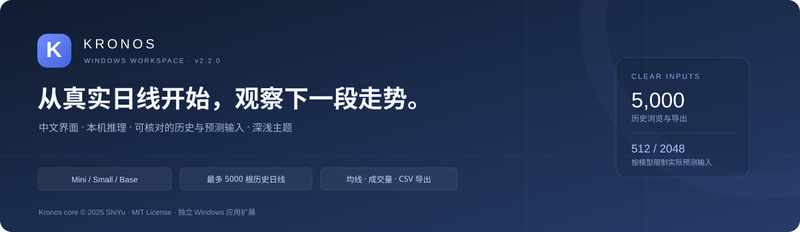

# Kronos 股票预测工作台 · Windows

**中文界面 · 本机推理 · Mini / Small / Base · 最多 5000 根历史日线**

> **版权与来源**：本项目基于 [shiyu-coder/Kronos](https://github.com/shiyu-coder/Kronos)。
> 原模型核心 **Copyright (c) 2025 ShiYu**，原作者 [MIT 许可证](./LICENSE)完整保留。
> 这是独立的 Windows 应用扩展，**不是 Kronos 官方发行版，也不代表原作者提供背书**。

当前版本：**2.2.0**。输入沪深 A 股代码，获取最新已收盘日线，在自己的电脑上生成模型预测，并核对、查看和导出实际输入。

**本工具用于学习、研究和辅助分析，不保证预测准确或收益，不连接券商，也不执行买卖。**

## 目录

- [快速开始](#快速开始)
- [功能一览](#功能一览)
- [如何理解历史与模型输入](#如何理解历史与模型输入)
- [模型选择](#模型选择)
- [读懂界面和结果](#读懂界面和结果)
- [数据来源与日期口径](#数据来源与日期口径)
- [下载、缓存与网络](#下载缓存与网络)
- [升级与文件位置](#升级与文件位置)
- [从源码运行](#从源码运行)
- [常见问题](#常见问题)
- [开发与验证](#开发与验证)
- [来源、版权与许可证](#来源版权与许可证)

## 快速开始

### 方式一：Windows 一键启动包

1. 打开仓库的 **Releases**，下载 **Kronos_Windows_Setup.zip**。也可使用[仓库中的安装包](./downloads/Kronos_Windows_Setup.zip)。
2. **完整解压**到一个新文件夹；请不要直接在 ZIP 内双击运行。
3. 安装 Python **3.10、3.11 或 3.12**，确保 Python Launcher 或 Python 可运行。
4. 双击 **START_KRONOS.cmd**。
5. 等待独立环境和 CPU 依赖安装完成，启动器会打开本机网页。
6. 输入股票代码，选择模型、预测长度和输入窗口，点击“获取行情并预测”。

首次使用需要联网下载依赖和所选模型权重。之后复用有效缓存。保持命令行窗口打开，按 **Ctrl+C** 停止；下次双击同一个启动文件即可继续使用。

如果 Hugging Face 官方站点连接困难，可以关闭旧窗口后选择 **START_KRONOS_MIRROR.cmd**。这是用户主动选择的 **hf-mirror.com 第三方公益镜像**，不是 Hugging Face 官方服务。两种入口都验证相同的官方固定版本、文件大小和 SHA256。

### 建议第一次这样试

| 设置 | 示例值 | 含义 |
| --- | --- | --- |
| 股票代码 | 601868 | 示例代码；请自行确认实际要研究的股票 |
| 模型 | Kronos-mini | 先验证本机下载、数据与推理流程 |
| 预测未来 | 5 个交易日 | 生成未来 5 个交易日的收盘价路径 |
| 下载历史行情 | 最多 5000 根 | 尝试获取长历史用于浏览、导出 |
| 本次预测输入 | 最近 256 根 | 实际送入模型的历史窗口 |

成功后先核对**股票代码、行情截至日期、数据源和实际输入根数**，再看曲线。

## 功能一览

| 功能 | 当前支持 |
| --- | --- |
| 股票选择 | 六位沪深 A 股代码，支持常见交易所前后缀和少量名称快捷输入 |
| 模型 | Kronos-mini、Kronos-small、Kronos-base |
| 历史行情 | 请求最多 500 / 1000 / 2000 / 5000 根；显示实际可用数量 |
| 预测输入 | 128 / 256 / 400 / 512 根；Mini 另支持 1024 / 1536 / 2048 根 |
| 预测长度 | 1 / 3 / 5 / 10 / 20 个交易日 |
| 图表 | 收盘价、预测分界、实际输入范围、历史成交量、可选 MA20 / MA60 |
| 图表历史范围 | 最近 80 / 256 / 1000 根或全部已下载历史 |
| 数据明细 | 预测明细与最近 20 根实际日线切换 |
| CSV | 预测、全部历史、实际预测输入分别导出 |
| 主题 | 浅色 / 深色切换，浏览器本地记住偏好 |
| 界面 | 中文、响应式布局、键盘可聚焦控件，无外部 CDN 脚本 |
| 本机服务 | 绑定 127.0.0.1，显示连接状态、数据来源和交易日历覆盖日期 |

**暂不支持**港股、美股、ETF、分钟行情、实时逐笔追踪、券商连接、自动交易、模型训练或一键滚动回测。

## 如何理解历史与模型输入

这两个设置控制不同的事情：

| 设置 | 作用 | 是否全部作为本次模型输入 |
| --- | --- | --- |
| 下载历史行情 = 5000 | 浏览长历史、导出数据、保留更多可核对的记录 | 否 |
| 本次预测输入 = 256 | 从上述历史的末尾选最近 256 根送入模型 | 是 |
| 预测未来 = 5 | 生成未来 5 个实际交易日期对应的预测 | 不属于历史输入 |

例如“下载 5000 根、输入 512 根、预测 5 天”，表示保存最多 5000 根历史，**用最新 512 根预测未来 5 个交易日**。

程序不会把 5000 根偷偷截成 512 根后仍声称使用了完整 5000 根。超出模型上限的输入会被限制或拒绝；界面同时显示下载数量、实际输入数量和起止日期。

如果上市时间较晚、长期无成交或接口覆盖不足，实际历史可能少于请求值。页面会显示原因和真实数量，不拼造日线。

## 模型选择

| 模型 | 参数规模 | 原生上下文上限 | 配套分词器 | 使用特点 |
| --- | ---: | ---: | --- | --- |
| Kronos-mini | 4.1M | 2048 根 | Kronos-Tokenizer-2k | 较轻，适合先验证流程或尝试长输入 |
| Kronos-small | 24.7M | 512 根 | Kronos-Tokenizer-base | 当前默认选项 |
| Kronos-base | 102.3M | 512 根 | Kronos-Tokenizer-base | 权重约 409 MB，CPU 推理更慢、占用更高 |

模型上限来自 [Kronos 官方模型说明](https://github.com/shiyu-coder/Kronos#-model-zoo)。本项目保持官方模型结构，没有把原生上下文改成 5000 根。

**更大的模型、更长的输入，不保证更准确。** 相同股票和预测期在不同窗口下可能得到相反方向。判断哪种设置适合某类股票，需要在多个历史日期做滚动回测；本版没有完成这类适用性验证。

当前预测设置沿用：随机种子 42、温度 1.0、top-p 0.9，生成 **3 条采样路径取平均**。固定种子使结果可复现，但相同结果的重复出现不代表独立验证；图中的路径也不是上涨概率或置信区间。

## 读懂界面和结果

1. **顶部概览**：最新已收盘价来自实际行情；首个、末个预测价来自模型生成。预测涨跌以最新实际收盘价为基准。
2. **图表**：蓝线为实际收盘价，橙色虚线为模型预测。浅蓝区域标记当前显示范围内的预测输入，浅橙区域标记未来预测区间。
3. **MA20 / MA60**：仅根据实际历史收盘价计算；切换显示不会重新运行模型，也不会把均线加入模型特征。
4. **成交量子图**：只显示实际历史的成交量，没有补造未来成交量。
5. **数据概况**：行情来源、历史根数、输入根数、最新实际日涨跌、实际成交量和输入窗口高低价。
6. **明细**：可在预测明细和最近 20 根实际日线之间切换。
7. **历史范围**：查看全部历史只改变图表显示，不改变已经完成的预测。

### 三种导出

| 导出 | 内容 | 用途 |
| --- | --- | --- |
| 预测 CSV | 未来日期、预测收盘价、相对最新收盘价变化 | 之后对照实际走势 |
| 全部历史 CSV | 本次取得的完整历史，最多 5000 根 | 浏览、研究或另行处理 |
| 预测输入 CSV | 这次实际送入模型的最近 N 根日线 | 核对、复现输入 |

历史字段为日期、开盘、最高、最低、收盘、成交量和成交额。导出使用 UTF-8 BOM，方便 Windows 表格软件打开。历史日期保持实际记录；不会使用演示行情替代下载失败的股票。

## 数据来源与日期口径

- **来源**：先检查东方财富，失败或覆盖不足时检查腾讯财经；选择最新且覆盖更多的单一来源。
- **价格**：前复权。成交量统一为股，成交额统一为元。
- **收盘口径**：北京时间 15:15 后尝试纳入当日日线，留出接口发布时间；此前使用上一已收盘交易日。
- **未来日期**：跳过周末和已核实的休市日。交易日历核实至 **2026-12-31**，超出范围时要求更新。
- **验证**：校验股票身份、最新日期、字段、有效成交及价格关系；实际预测输入要求价格为正。
- **早期前复权数据**：部分较早价格可能非正，保留历史展示值；包含非正价格的预测输入窗口会被拒绝。
- **不足和失败**：上市时间、停牌、限流、网络或接口变化都可能导致历史不足。数据过期时不会继续显示旧股票的预测作为新结果。

公开行情接口不是本项目控制的服务；检查通过也不能保证第三方数据绝无错误。使用前请与可靠行情来源交叉核对。

## 下载、缓存与网络

- 随包包含五份官方配置；**不包含真实模型权重**。
- 模型权重固定到官方提交，按官方文件大小和 SHA256 校验。见 [manifest.json](./stock_ui/model_configs/manifest.json)。
- 公开下载不使用 API Key，不向镜像发送 HF 令牌。
- 元数据等待至少 60 秒，文件读取超时至少 300 秒；临时失败最多重试 3 次。
- 正常网络超时保留可续传缓存；仅完整性失败时重新获取文件。
- 保存时解析缓存真实文件，复制、刷盘、校验，再替换目标，避免相对缓存链接失效。
- 下载或保存失败不会绕过校验继续加载模型。
- 不修改 Windows 全局代理、证书或安全设置。

详细手动放置方式见 [docs/TROUBLESHOOTING.md](./docs/TROUBLESHOOTING.md) 和随包使用说明。

## 升级与文件位置

关闭旧运行窗口，把新版 ZIP 完整解压到新文件夹，再双击原入口。有效权重与缓存可复用，不需要手工删除旧项目。

默认目录为 C:\AI\Kronos；如果没有写权限，使用 Windows LOCALAPPDATA 下的 Kronos 目录。以启动窗口显示的位置为准。

| 位置 | 用途 |
| --- | --- |
| stock-forecast-v2-… | 安装后的项目源码；升级时保留旧项目 |
| .kronos-runtime | 独立 Python 环境 |
| model_files | 已校验的模型权重和配置 |
| logs | 安装与运行日志 |
| 项目 results | 运行期间产生的预测记录 |

日志可能包含本机路径或运行信息，分享前请自行检查；本仓库不上传运行日志、环境文件、模型缓存或个人券商资料。

## 从源码运行

Windows 用户优先使用一键包。开发者可克隆源码并手动建立独立环境；不需要 OpenAI API Key。

在仓库根目录运行以下 PowerShell 命令（使用已安装的 Python 3.10；也可改为 3.11 / 3.12）：

~~~powershell
py -3.10 -m venv .venv
.\.venv\Scripts\python.exe -m pip install -r requirements.txt numpy==1.26.4
.\.venv\Scripts\python.exe stock_ui\app.py --port 7070
~~~

无需激活环境或修改 PowerShell 执行策略。打开命令行显示的本机地址。手动源码方式复用相同的权重校验和行情逻辑。

运行源码与下载包的目录组织不同，权重会放在项目父目录的 model_files；日志或报错中会给出实际目标路径。Windows 启动器会自动准备配置目录。

## 常见问题

| 现象 | 先检查什么 |
| --- | --- |
| 找不到 requirements.txt | 终端是否处于仓库根目录；一键包是否完整解压 |
| 找不到虚拟环境中的 python.exe | 是否已经成功创建 .venv；也可直接使用一键启动器 |
| HF ReadTimeout | 当前下载来源是否可达；保留窗口等待重试，必要时选择明确标注的第三方镜像入口 |
| Tokenizer 缺少构造参数 | 确认使用完整新版包，配置目录和程序版本匹配 |
| 权重校验或保存失败 | 查看目标路径、预期大小、实际大小和 SHA256；不要关闭校验 |
| 只有几百或几千根历史 | 可能受上市时间、无成交日或接口覆盖限制，查看实际日期范围 |
| 切换窗口后方向相反 | 模型对上下文敏感；固定输入再比较，不以看涨结果作为参数选择标准 |
| Base 很慢或内存吃紧 | 先改用 Mini / 较短输入；本版没有声明最低硬件要求或实测推理时长 |
| 网页连不上本机服务 | 启动窗口是否仍打开；使用启动器实际打开的端口 |
| 跨到 2027 年无法预测日期 | 本版交易日历只核实到 2026-12-31，需要更新日历 |

完整排错说明见 [docs/TROUBLESHOOTING.md](./docs/TROUBLESHOOTING.md)。

## 开发与验证

~~~text
model/                     上游 Kronos 模型核心
stock_ui/app.py            本机 HTTP 服务、任务与预测接口
stock_ui/market_data.py    行情获取、单位和日期校验
stock_ui/model_loader.py   固定模型配置、缓存和权重校验
stock_ui/index.html        中文界面、主题、图表和导出交互
stock_ui/model_configs/    官方配置与固定权重清单
setup_kronos.py            Windows 安装与启动
tests/                     开发专用小文件、行情和模型替身
tools/check_ui.py          HTTP 服务与界面脚本验证
downloads/                 已构建的 Windows 一键包
THIRD_PARTY_LICENSES/       第三方许可证
~~~

测试不要求下载真实模型权重：

~~~bash
python -m unittest discover -s tests -p "test_*.py" -v
python tools/check_ui.py
python setup_kronos.py --verify-package
~~~

界面检查需要 Node.js。它针对独立的模拟 DOM 和本机真实 HTTP 接口，覆盖主题、模型选择、历史均线、成交量、明细切换、5000 根图表、CSV、错误状态和来源限制；不能代替真实浏览器外观检查。

当前验证覆盖 39 项 Python 检查以及界面交互和安装包检查。**尚未完成真实 Windows 电脑上的全流程联网测试和真实 Base 权重推理验证**，不宣称已验证交易胜率。

修改源码后，不能只替换安装包里的单个文件：需要重建 official_source.zip、更新启动器载荷 SHA256、版本号，并重建外层 Windows ZIP，保持配置、程序和启动器一致。

## 来源、版权与许可证

### Kronos 原项目

- 原项目：[shiyu-coder/Kronos](https://github.com/shiyu-coder/Kronos)
- 论文：[Kronos: A Foundation Model for the Language of Financial Markets](https://arxiv.org/abs/2508.02739)
- 固定核心提交：67b630e67f6a18c9e9be918d9b4337c960db1e9a
- **原版权声明：Copyright (c) 2025 ShiYu**
- **许可证：[MIT License](./LICENSE)，完整原文保留**
- 原作者版权同时显示在本机应用页脚，附上上游链接和许可证链接。

### 本项目扩展

新增中文界面、Windows 安装启动器、自选股票行情适配、日历、权重保存校验和开发检查。具体来源与修改边界见 [NOTICE.md](./NOTICE.md)。保留上游核心文件、配置来源和第三方许可证，不将上游核心描述为本项目原创。

行情字段参考 [AKShare 官方文档](https://akshare.akfamily.xyz/data/stock/stock.html)，保留 [AKShare MIT 许可证](./THIRD_PARTY_LICENSES/AKShare-MIT.txt)。模型权重不随仓库再分发，首次使用从所选下载源获取并校验。
